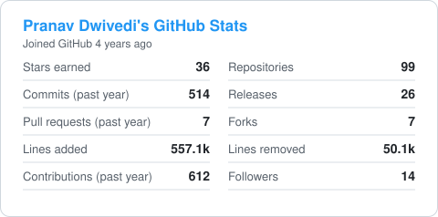
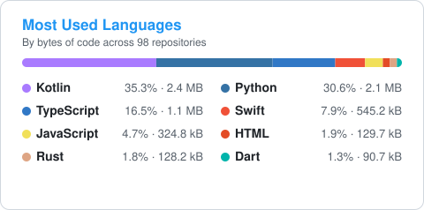

<!-- markdownlint-disable MD033 MD041 -->

  

  <h1>Hi there, I'm Pranav Dwivedi </h1>

  

  
<b>Building agents meant for AGI</b> · Computer vision · Privacy-first apps for Android &amp; macOS

  
  
  

 

## 🧭 What I Build — At a Glance

<table>
  <tr>
    <td align="center" width="25%">
      <h3>📱</h3>
      <a href="#-android-apps"><b>Android Apps</b></a> 
      Kotlin · Jetpack Compose  
      <a href="https://github.com/pronzzz/monarch">Monarch</a> · <a href="https://github.com/pronzzz/Discipline">Discipline</a> · <a href="https://github.com/pronzzz/PocketPod">PocketPod</a>
    </td>
    <td align="center" width="25%">
      <h3>🍎</h3>
      <a href="#-macos-apps"><b>macOS Apps</b></a> 
      Swift · SwiftUI · AppKit  
      <a href="https://github.com/pronzzz/aura">Aura</a> · <a href="https://github.com/pronzzz/zenpad">ZenPad</a> · <a href="https://github.com/pronzzz/inkflow">Inkflow</a>
    </td>
    <td align="center" width="25%">
      <h3>🤖</h3>
      <a href="#-ai-agents-llms-and-mcp"><b>AI Agents &amp; LLMs</b></a> 
      Ollama · RAG · MCP  
      <a href="https://github.com/pronzzz/zeta">Zeta</a> · <a href="https://github.com/pronzzz/jarvis-v">Jarvis-V</a> · <a href="https://github.com/pronzzz/braintube">BrainTube</a>
    </td>
    <td align="center" width="25%">
      <h3>📸</h3>
      <a href="#-computer-vision-and-deep-learning"><b>Computer Vision</b></a> 
      PyTorch · OpenCV · GANs  
      <a href="https://github.com/pronzzz/mozzaic">Mozzaic</a> · <a href="https://github.com/pronzzz/graphiteai">GraphiteAI</a> · <a href="https://github.com/pronzzz/retinaguard">RetinaGuard</a>
    </td>
  </tr>
  <tr>
    <td align="center" width="25%">
      <h3>📊</h3>
      <a href="#-machine-learning-and-data-science"><b>ML &amp; Data Science</b></a> 
      scikit-learn · PyTorch · Pandas  
      <a href="https://github.com/pronzzz/car-price-prediction">Car Price</a> · <a href="https://github.com/pronzzz/earthquake-prediction">Earthquakes</a> · <a href="https://github.com/pronzzz/movie-recommendation-system">Recommender</a>
    </td>
    <td align="center" width="25%">
      <h3>🦀</h3>
      <a href="#-systems-cli-and-devtools"><b>Systems &amp; CLI</b></a> 
      Rust · Go · TUIs  
      <a href="https://github.com/pronzzz/vajrachain">VajraChain</a> · <a href="https://github.com/pronzzz/time-machine">Time Machine</a> · <a href="https://github.com/pronzzz/aegis">Aegis</a>
    </td>
    <td align="center" width="25%">
      <h3>🌐</h3>
      <a href="#-web-and-creative-coding"><b>Web &amp; Creative</b></a> 
      React · TypeScript · WebGL  
      <a href="https://github.com/pronzzz/sysarch-interactive">SysArch</a> · <a href="https://github.com/pronzzz/mirrorlab">MirrorLab</a> · <a href="https://github.com/pronzzz/ledgerllama">LedgerLlama</a>
    </td>
    <td align="center" width="25%">
      <h3>🔧</h3>
      <a href="#-robotics-hardware-and-homelab"><b>Robotics &amp; Homelab</b></a> 
      SolidWorks · Raspberry Pi  
      <a href="https://github.com/pronzzz/robotic-manipulator">Manipulator</a> · <a href="https://github.com/pronzzz/Pi-hole-on-a-Raspberry-Pi-B-ARMv6">Pi-hole</a> · <a href="https://github.com/pronzzz/monero-mining">Pi Miner</a>
    </td>
  </tr>
</table>

## 🛠️ Tech Stack

| | |
| :-- | :-- |
| **Languages** |  |
| **AI / ML** |  &nbsp;    |
| **Apps** |  &nbsp;   |
| **Web & Backend** |  |
| **Infra** |  |

## 📱 Android Apps

| Project | What it does | Stack |
| :-- | :-- | :-- |
| **[Monarch](https://github.com/pronzzz/monarch)** | Gamified fitness: real workouts, steps, sleep and study turn into RPG XP, stats and levels |    |
| **[Discipline](https://github.com/pronzzz/Discipline)** | Private, offline-first calorie tracker with a One UI-style interface and Health Connect sync |   |
| **[PocketPod](https://github.com/pronzzz/PocketPod)** | Minimal, iPod-inspired local music player: no cloud, no clutter |  |
| **[Learning Tracker](https://github.com/pronzzz/learning-tracker)** | Track topics, study sessions and resources, with a Glance home-screen widget |   |
| **[GBAForge](https://github.com/pronzzz/gbaforge)** | Cross-platform Pokémon FireRed/Emerald ROM-hacking suite |   |
| **[Awesome Android FOSS](https://github.com/pronzzz/awesome-android-foss)** | Curated list of privacy-respecting, open-source Android apps |  |

## 🍎 macOS Apps

| Project | What it does | Stack |
| :-- | :-- | :-- |
| **[Aura](https://github.com/pronzzz/aura)** | Context-aware command center for macOS inspired by the Dynamic Island: clipboard, media and local AI |   |
| **[ZenPad](https://github.com/pronzzz/zenpad)** | Distraction-free native text editor for writers and developers, with a local AI assistant |   |
| **[Inkflow](https://github.com/pronzzz/inkflow)** | Lightweight, modern paint app built on SwiftUI and Core Graphics |   |

## 🤖 AI Agents, LLMs and MCP

| Project | What it does | Stack |
| :-- | :-- | :-- |
| **[Zeta](https://github.com/pronzzz/zeta)** | Privacy-first autonomous agent with long-term memory that runs 100% locally |   |
| **[Jarvis-V](https://github.com/pronzzz/jarvis-v)** | Offline voice assistant that natively understands Hinglish, with tool calling |   |
| **[BrainTube](https://github.com/pronzzz/braintube)** | Local "second brain" for YouTube: transcribe, search, build knowledge graphs and flashcards |   |
| **[RAGnarok](https://github.com/pronzzz/RAGnarok)** | Turns messy PDFs into clean Markdown for RAG pipelines, with VLM fallback |   |
| **[NeuroNest MCP](https://github.com/pronzzz/neuronest-mcp)** | MCP server that turns an Obsidian/Logseq vault into a semantic knowledge graph for agents |   |
| **[baremetal-react](https://github.com/pronzzz/baremetal-react)** | The ReAct (Reason + Act) agent loop in ~110 lines with zero dependencies |  |

<b>More AI and LLM projects (15)</b>

 

- **[GhostInTheShell MCP](https://github.com/pronzzz/GhostInTheShell-mcp)**: sandboxed, read-only MCP server for system health, Docker and log diagnostics
- **[LinkForge MCP](https://github.com/pronzzz/linkforge-mcp)**: replaces raw SaaS CRUD calls with token-optimized semantic queries
- **[SudoAI](https://github.com/pronzzz/sudoai)**: "chat with your OS", a local system-management agent with anomaly detection
- **[HermitMail](https://github.com/pronzzz/hermitmail)**: fully local newsletter generator with Llama 3 and FAISS
- **[LLM Search Engine](https://github.com/pronzzz/llm-search-engine)**: local hybrid-search RAG engine with Streamlit and FAISS
- **[AtomGPT](https://github.com/pronzzz/atomgpt)**: an evolutionary GPT built from scratch with its own autograd
- **[PrismNLG](https://github.com/pronzzz/prismNLG)**: modular, explainable natural-language generation on Hugging Face Transformers
- **[Booktures](https://github.com/pronzzz/booktures)**: turns any PDF book into an illustrated visual novel
- **[TubeSage](https://github.com/pronzzz/tubesage)**: AI content-intelligence engine for YouTube creators
- **[QuestLog](https://github.com/pronzzz/questlog)**: CLI that generates RPG-style skill trees for learning anything
- **[Prismify](https://github.com/pronzzz/prismify)** and **[SyntaxSensei](https://github.com/pronzzz/syntaxsensei)**: AI-powered code refactoring and multi-language linting
- **[Roastify](https://github.com/pronzzz/roastify)**: Gemini ruthlessly judges your Spotify taste
- **[BERT Text Classification](https://github.com/pronzzz/BERT-Text-Classification)**: fine-tuning DistilBERT for news classification
- **[Gradio AI Chatbot](https://github.com/pronzzz/Gradio-AI-Chatbot)**: LLM chatbot with a Gradio web UI

## 📸 Computer Vision and Deep Learning

| Project | What it does | Stack |
| :-- | :-- | :-- |
| **[Mozzaic](https://github.com/pronzzz/mozzaic)** | High-fidelity pixel-art engine for images and video with GPU dithering and optical flow |   |
| **[GraphiteAI](https://github.com/pronzzz/graphiteai)** | End-to-end pix2pix GAN that turns photos into hand-drawn sketches |   |
| **[RetinaGuard](https://github.com/pronzzz/retinaguard)** | Ensemble ResNet system that grades diabetic retinopathy from retina scans |  |
| **[Elusive Polyps Detection](https://github.com/pronzzz/elusive-polyps-detection)** | Temporal, dual-path RetinaNet that catches polyps missed in colonoscopies |  |
| **[DeepSteer-Vis](https://github.com/pronzzz/deepsteer-vis)** | Self-driving agent trained by behavioral cloning, explained with Grad-CAM |  |
| **[Super Mario Agent](https://github.com/pronzzz/super-mario-agent)** | Rainbow DQN reinforcement-learning agent that learns to clear Mario levels |   |

<b>More computer vision projects (13)</b>

 

- **[SignifyAI](https://github.com/pronzzz/signifyai)**: real-time hand-gesture recognition with VGG-16 transfer learning
- **[FocusFlow](https://github.com/pronzzz/focusflow)**: handwritten digit recognition with Grad-CAM explanations
- **[FluxBeat](https://github.com/pronzzz/fluxbeat)**: multi-label music genre classification with an explainable CRNN
- **[Lane Detection](https://github.com/pronzzz/lane-detection)**: real-time lane-detection pipeline for ADAS
- **[Plant Disease Detection](https://github.com/pronzzz/plant-disease-detection)**: field-ready classifier built for mobile and edge deployment
- **[Pest Prediction and Detection](https://github.com/pronzzz/pest-prediction-detection)**: detects and forecasts agricultural pest infestations
- **[Hidden Interface Rendering](https://github.com/pronzzz/hidden-interface-rendering-system)**: renders high-contrast UIs through solid materials
- **[Reverse Image Lodging](https://github.com/pronzzz/reverse-image-lodging)**: find hotels from a photo with deep feature extraction
- **[Face Mask Detection](https://github.com/pronzzz/face-mask-detection)**: real-time detection with OpenCV and MobileNet
- **[Object Detection Model](https://github.com/pronzzz/object-detection-model)**: identify, locate and classify objects in images
- **[Weather Prediction](https://github.com/pronzzz/weather-prediction)**: classifies weather conditions from images with EfficientNet
- **[Fingerprint Classification](https://github.com/pronzzz/Fingerprint-classification)**: biometric classification on the SOCOFing dataset
- **[Face Detection](https://github.com/pronzzz/face-detection)**: classic Haar-cascade face detection with OpenCV

## 📊 Machine Learning and Data Science

| Project | What it does | Stack |
| :-- | :-- | :-- |
| **[Car Price Prediction](https://github.com/pronzzz/car-price-prediction)** | Modular PyTorch pipeline for used-car pricing with robust feature engineering |  |
| **[Earthquake Prediction](https://github.com/pronzzz/earthquake-prediction)** | Analyzes seismic patterns to predict earthquake magnitudes |  |
| **[Movie Recommender](https://github.com/pronzzz/movie-recommendation-system)** | Hybrid collaborative + content-based recommendation engine |  |
| **[Backprop Bandits](https://github.com/pronzzz/backdrop-bandits)** | Terminal strategy game where you train and battle ML models |  |

<b>More data science projects (8)</b>

 

- **[Trend Intelligence System](https://github.com/pronzzz/trend-intelligence-system)**: spots and visualizes emerging market trends
- **[Fuel Efficiency Prediction](https://github.com/pronzzz/fuel-effeciency-prediction)**: regression model for vehicle MPG
- **[Credit Card Approval](https://github.com/pronzzz/credit-card-approval-detection)**: end-to-end approval-prediction pipeline
- **[Blood Donation](https://github.com/pronzzz/blood-donation)**: data-driven donor management and prediction
- **[Stock Price Prediction](https://github.com/pronzzz/stock_price_prediction)**: comparing KNN, linear regression and LSTMs
- **[Diabetes Prediction](https://github.com/pronzzz/diabetes-prediction)**: KNN on the Pima Indians dataset
- **[Red Wine Quality](https://github.com/pronzzz/red-wine-quality)**: tuned random forest classifier
- **[WasabiGit](https://github.com/pronzzz/wasabigit)**: GitHub Actions bot that teaches you Japanese vocabulary daily

## 🦀 Systems, CLI and DevTools

| Project | What it does | Stack |
| :-- | :-- | :-- |
| **[VajraChain](https://github.com/pronzzz/vajrachain)** | Modular blockchain framework: Ed25519-signed ledger, libp2p networking, smart-contract VM |  |
| **[Time Machine](https://github.com/pronzzz/time-machine)** | TUI for browsing and reverting Git states through the reflog |   |
| **[FlowPrompt](https://github.com/pronzzz/flowprompt)** | Terminal tool for managing prompts and injecting code into LLM workflows |  |
| **[Aegis](https://github.com/pronzzz/aegis)** | Self-managed, zero-trust encrypted backup system with deduplication |  |
| **[ZenMonitor](https://github.com/pronzzz/zenmonitor)** | Minimal self-hosted uptime monitor with configuration as code |   |

<b>More tools (5)</b>

 

- **[Kernel Architect](https://github.com/pronzzz/kernel-architect)**: cyberpunk terminal simulation game in Rust and Ratatui
- **[ZipWizard](https://github.com/pronzzz/zipwizard)**: picks the best compression algorithm for your data automatically
- **[JSON-Titan](https://github.com/pronzzz/json-titan)**: single-file browser tool for viewing and diffing massive JSON
- **[Scalable Telegram Bot](https://github.com/pronzzz/scalable-telegram-bot)**: async, microservice-style bot architecture on aiogram
- **[DocxFormNet](https://github.com/pronzzz/docxformnet)**: automated data extraction from DOCX forms

## 🌐 Web and Creative Coding

| Project | What it does | Stack |
| :-- | :-- | :-- |
| **[SysArch Interactive](https://github.com/pronzzz/sysarch-interactive)** | Deterministic distributed-systems simulator with a physics-based particle engine |   |
| **[MirrorLab](https://github.com/pronzzz/mirrorlab)** | Open-source photo editor in the browser with RAW support and tone curves |   |
| **[LedgerLlama](https://github.com/pronzzz/ledgerllama)** | Zero-backend finance and habit tracker with SQLite-WASM and in-browser AI |   |
| **[FlowArt](https://github.com/pronzzz/flowart)** | Immersive 3D digital-art gallery and curation app |   |
| **[AlgoViz](https://github.com/pronzzz/algo-viz)** | Interactive algorithm visualizer that links code to concept |  |

<b>More web projects (10)</b>

 

- **[PlaylistHydra](https://github.com/pronzzz/PlaylistHydra)**: batch YouTube playlist downloader built for 1000+ videos
- **[HomeoVault](https://github.com/pronzzz/homeovault)** and **[SimpleVault](https://github.com/pronzzz/simplevault)**: FastAPI inventory systems for pharmacies and small shops
- **[Global Arcade](https://github.com/pronzzz/global-arcade)**: real-time multiplayer board games on Firebase
- **[FireWordle](https://github.com/pronzzz/firewordle)**: responsive Wordle clone in React
- **[Navzfolio](https://github.com/pronzzz/navzfolio)**: photography portfolio with a radial scroll interaction
- **[Posties](https://github.com/pronzzz/posties)**: digital postcard collection with a 3D carousel
- **[RingSathi](https://github.com/pronzzz/ringsathi)**: verified directory of Indian government helplines (in progress)
- **[pranavdwivedi.dev](https://github.com/pronzzz/pranavdwivedi.dev)**: my developer portfolio
- **[Will You Be My Valentine?](https://github.com/pronzzz/willyoubemyvalentine)**: a playful animated web page

## 🔧 Robotics, Hardware and Homelab

| Project | What it does | Stack |
| :-- | :-- | :-- |
| **[Robotic Manipulator](https://github.com/pronzzz/robotic-manipulator)** | 4-DOF pick-and-place robotic arm designed for an advanced robotics course |  |
| **[Pi-hole on ARMv6](https://github.com/pronzzz/Pi-hole-on-a-Raspberry-Pi-B-ARMv6)** | Real-world deployment log for network-wide ad blocking on a Pi B+/Zero |  |
| **[Monero Mining on a Pi](https://github.com/pronzzz/monero-mining)** | Educational guide to mining XMR on a Raspberry Pi 3B+ |  |

## 📈 GitHub Stats

  
  

## ⚡ Recent Activity

<!--START_SECTION:activity-->
1. 🚀 Published release [Wheelhouse 1.0](https://github.com/pronzzz/Wheelhouse/releases/tag/v1.0.0) in [pronzzz/Wheelhouse](https://github.com/pronzzz/Wheelhouse)
2. 🎉 Merged PR [#1](https://github.com/pronzzz/Wheelhouse/pull/1) in [pronzzz/Wheelhouse](https://github.com/pronzzz/Wheelhouse)
3. 💪 Opened PR [#1](https://github.com/pronzzz/Wheelhouse/pull/1) in [pronzzz/Wheelhouse](https://github.com/pronzzz/Wheelhouse)
4. 🎉 Merged PR [#3](https://github.com/pronzzz/awesome-android-foss/pull/3) in [pronzzz/awesome-android-foss](https://github.com/pronzzz/awesome-android-foss)
<!--END_SECTION:activity-->

<i>Let's connect and build something amazing together!</i>

